

<a href="README.md">简体中文</a> · <b>English</b>

<h1>Achievement Collection</h1>

<strong>Every game you have 100%-completed, bound into an album you can flip through.</strong>

A Steam Millennium plugin · works with the stock Steam client and with other themes

  
  
  

  <a href="#installation"><b>Installation</b></a> · <a href="#features">Features</a> · <a href="#settings">Settings</a> · <a href="#notes">Notes</a> · <a href="#support">Support</a>

> **About language:** the plugin interface is currently in Simplified Chinese only. English support for the plugin itself is planned. The screenshots below show the Chinese interface.

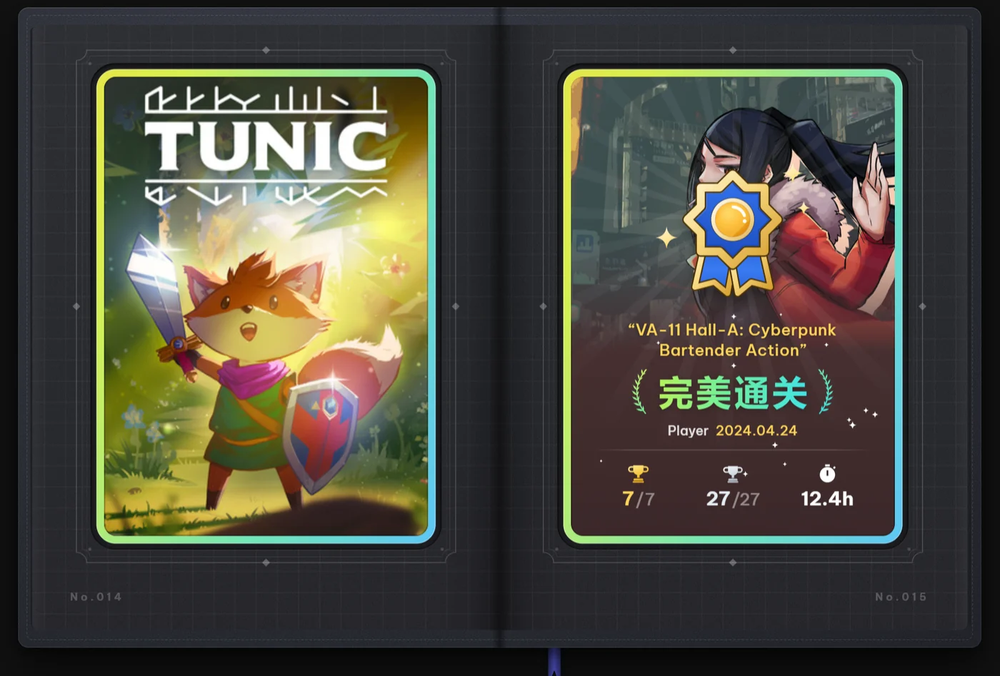

## Installation

Download the latest version from [Releases](https://github.com/Kevin0036/steam_achievement_improve/releases/latest) and pick the package that fits you:

| | For | Download |
| --- | --- | --- |
| **All-in-one package** | You have never installed Millennium and want everything set up in one go | `AchievementCollection-Lazy-<version>-Windows.zip` |
| **Plugin package** | You already use Millennium | `AchievementCollection-Plugin-<version>-Windows.zip` |

**All-in-one package**: unzip it and double-click `Install.bat`. The script finds Steam and installs Millennium and the plugin. If Millennium is already installed, the same script only updates the plugin and leaves your other themes and plugins alone.

**Plugin package**:

1. Install and enable [Millennium](https://github.com/SteamClientHomebrew/Millennium).
2. Unzip the package and put the whole `AchievementCollection` folder into `<Steam install folder>/millennium/plugins/`.
3. Restart Steam and enable 「成就收藏册」 (Achievement Collection) in Millennium's plugin list.
4. Restart Steam once more. 「★ 成就卡包」 (Achievement Card Pack) now appears in the top menu of your library.

**Updating**: the plugin checks for a new version every time you open the card pack, and shows a reminder in the top-right corner of the album while one is available. Click 「自动更新」 (Update automatically), then restart Steam. Your settings and album cache are kept.

## Features

### Achievement card pack

Adds a 「成就卡包」 page to your Steam library that binds every 100%-completed game into an album you can flip left and right. Each card shows the game's cover, completion date, achievement count, rare achievements and playtime.

- **Turning pages**: scroll the mouse wheel, or click anywhere on the left or right page.
- **Quick flip**: click or drag the bookmark to jump to the other end of the album. When you come back, it remembers where you were.
- **Layout**: one large card per page, or four small cards per page.
- **Binding**: 「顺序入册」 (In order) sorts cards from oldest to newest completion, so each new game goes at the end. 「最新优先」 (Newest first) puts new cards at the front.

The first time you open it, a guided tour shines a spotlight on the pages, the bookmark and the buttons, explaining each step in one sentence. You can try the hands-on steps right away. To see it again later, click 「查看引导」 (View guide) in the settings.

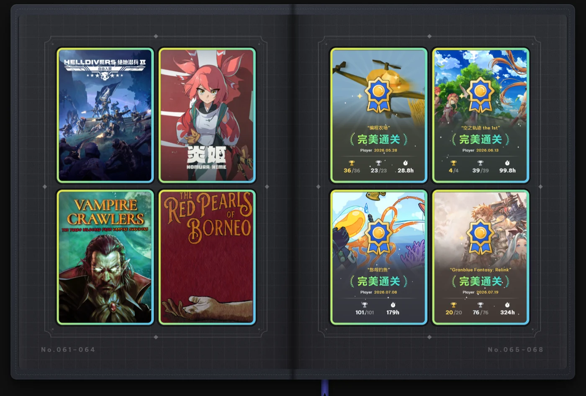

### Achievement sets

Steam now splits a game's base-game and DLC achievements into separate achievement sets, and the card pack judges completion set by set:

- **Base-game set complete**: the game goes into the album with a blue badge in the middle of its card. A DLC set released later will not push it out of the album.
- **Base game and every DLC set complete**: the badge turns blue on the left and purple on the right. The gold and silver trophy counts include the DLC achievements, and the day you completed every set is written above them. A card that is already in the album gets upgraded the next time you open the card pack.

The completion date on a card is always the day you completed the base game, so an upgraded card keeps its place in the album.

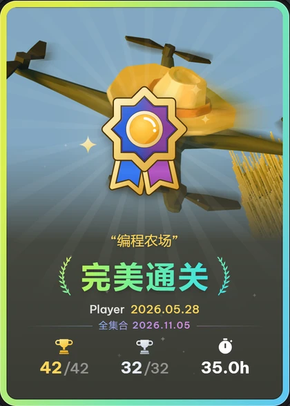

### Album styles

Four albums, each with its own paper, cover, bookmark and frames. Switch between them in the settings; the change applies immediately.

<table>
  <tr>
    <td width="50%">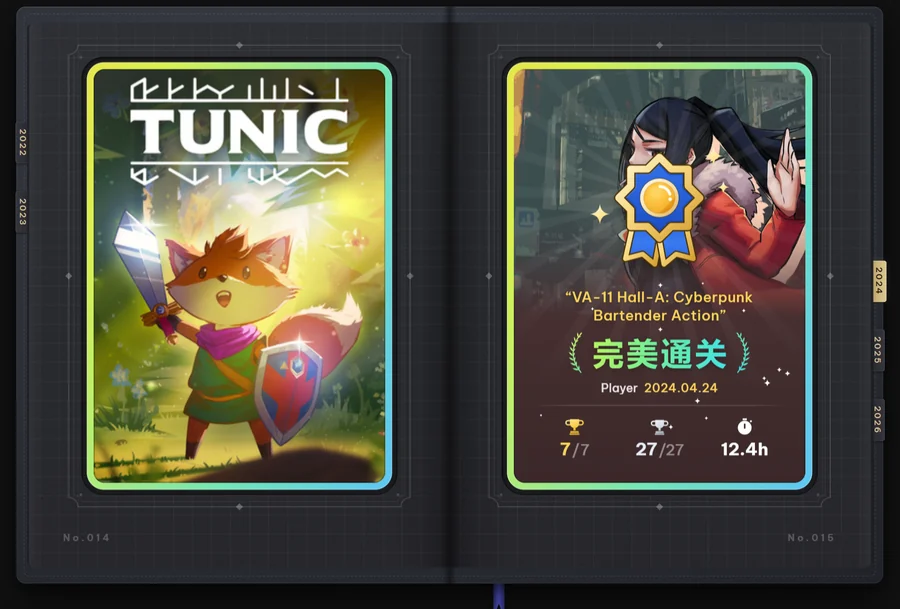</td>
    <td width="50%">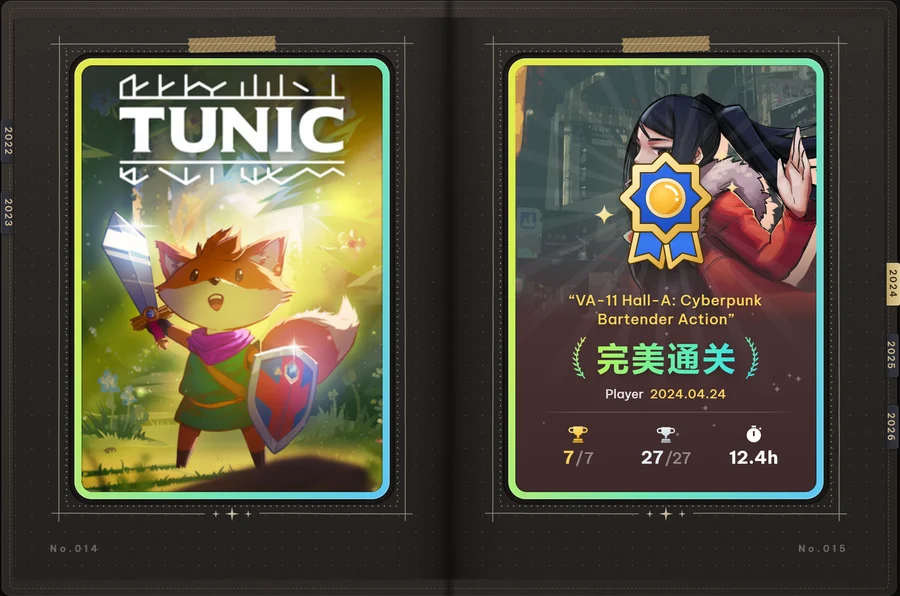</td>
  </tr>
  <tr>
    <td align="center"><b>Black grid card</b> (方格黑卡) Black card stock with a faint grid and printed frames</td>
    <td align="center"><b>Dotted journal</b> (墨点手账) Warm black paper with a dot grid, hand-drawn ink lines and washi tape</td>
  </tr>
  <tr>
    <td width="50%">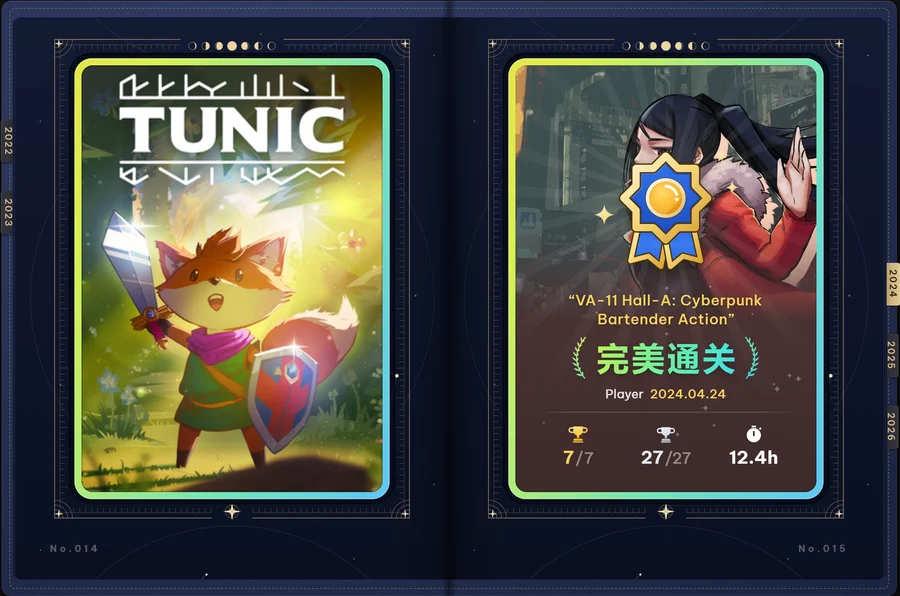</td>
    <td width="50%">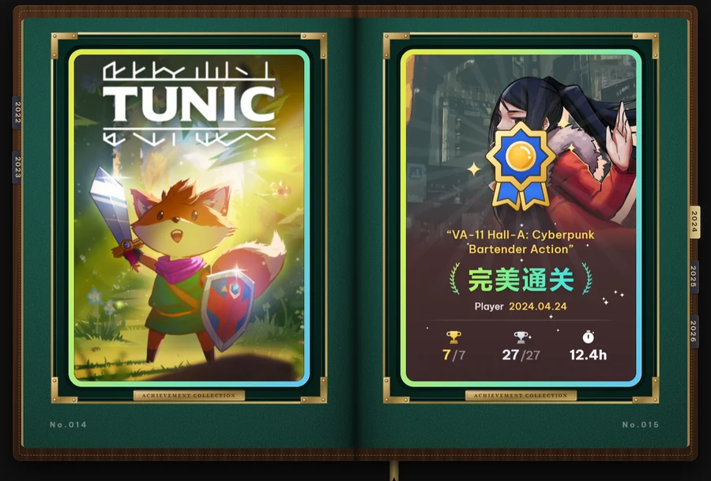</td>
  </tr>
  <tr>
    <td align="center"><b>Lunar star chart</b> (月相星图) A deep-blue star chart with scale rings, a row of moon phases and a purple bookmark</td>
    <td align="center"><b>Green felt table</b> (绿绒牌桌) Green baize with a wooden rail and poker chips at the corners</td>
  </tr>
</table>

### Year pages

The album is grouped by the year you completed each game, and every year opens with four pages.

**The year page and Favorites of the year** share one spread: on the left are the year's stats and three badge stamps, on the right are your three favorite games. You choose the stamps and ticket stubs yourself.

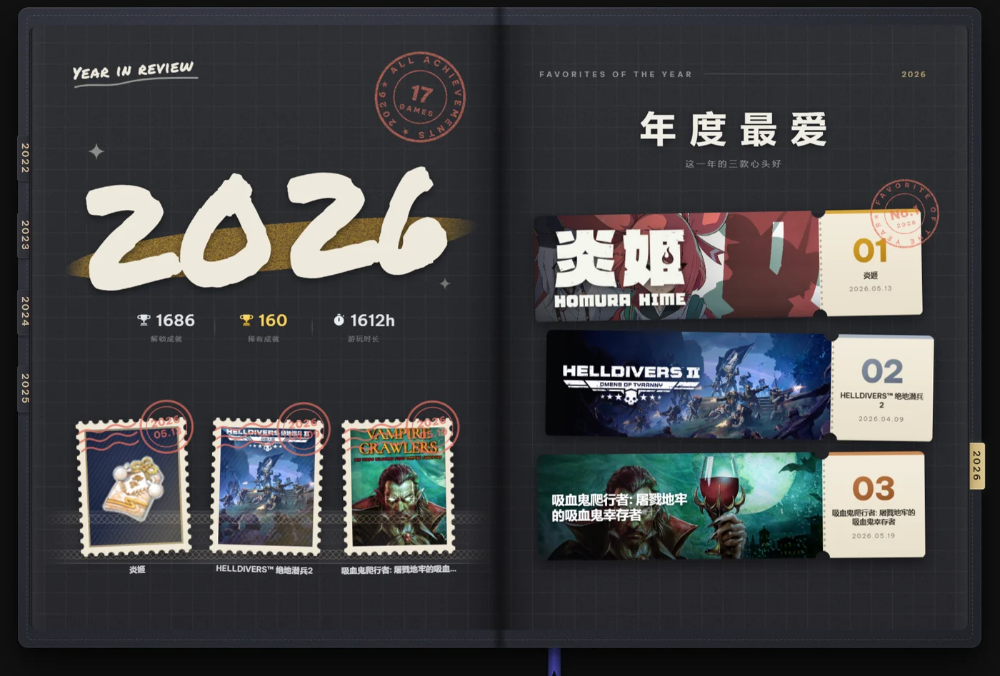

**Monthly footprints** and **the year's index** sit before and after that spread. The footprints show how your year went, and you can click a month to see every game from it. Click a row in the index to jump to that card.

<table>
  <tr>
    <td width="50%">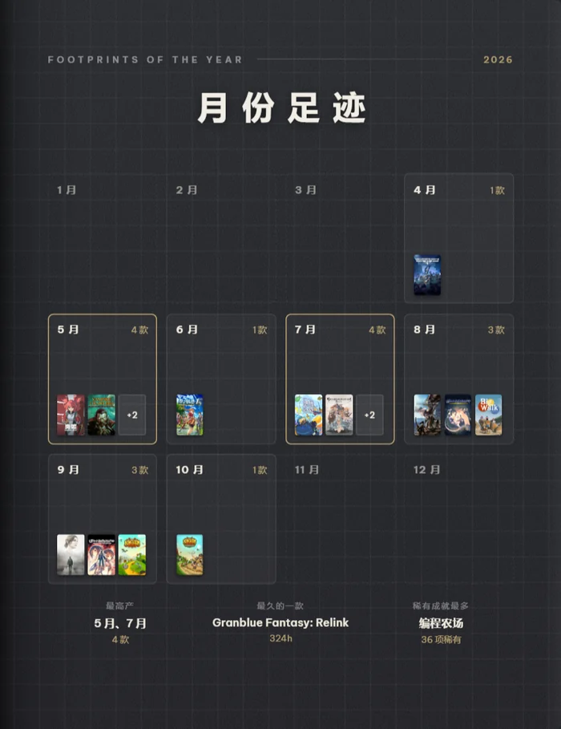</td>
    <td width="50%">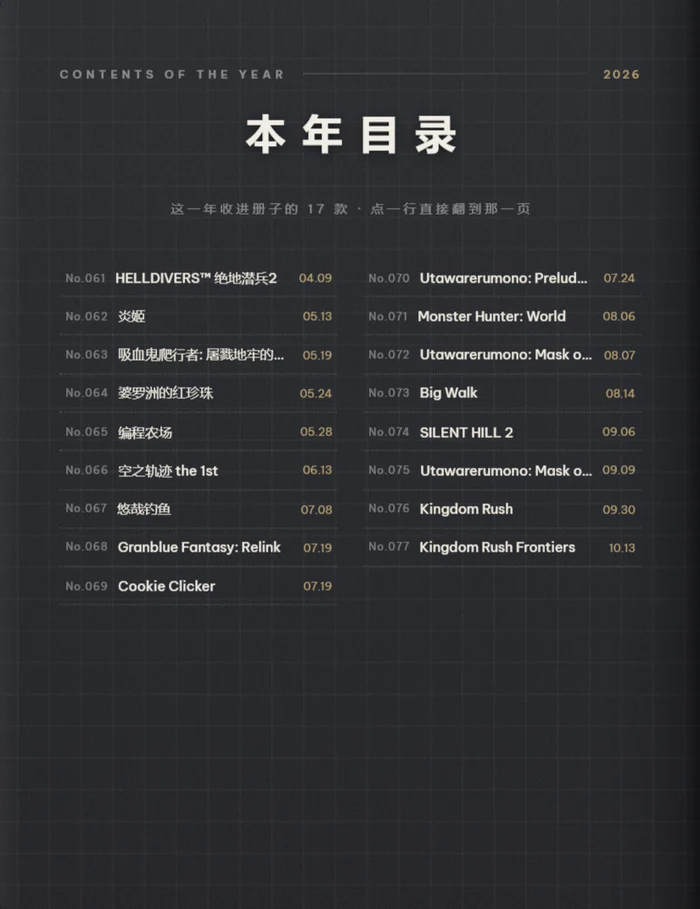</td>
  </tr>
  <tr>
    <td align="center"><b>Monthly footprints</b> Which games you completed each month; click a month to see them all. Also your most productive month, your longest game and the game with the most rare achievements</td>
    <td align="center"><b>The year's index</b> Every game of the year; click a row to jump to its page. In a busy year the index is split into sheets you flip within the page</td>
  </tr>
</table>

A column of year tabs also runs along the fore-edge of the album; click one to jump to that year.

More details

- When you reach a year page, a red seal stamps down and three postmarks follow one after another. If your system has "reduce motion" turned on, they appear without animation.
- For each game you can pick a regular badge (levels 1–5), a foil badge, or the game's cover. Games without a badge are marked as such.
- The No. 1 ticket stub gets a red 「FAVORITE OF THE YEAR · No.1」 seal.
- Games without a completion date go into an 「更早」 (Earlier) group at the very front, which has no year pages.

### New cards

After you complete a game, the next time you open the card pack you see its card drop into a reserved slot. The animation depends on how long you played:

- **Under 15 hours**: the card slots straight in. Two animations, lightning and fire, take turns.
- **15–50 hours** (and games whose playtime cannot be read): the card rises from the middle of the page, flips over and drops into its slot.
- **Over 50 hours**: the page dims, the card is slowly lifted, held up for a moment and then set down.

There is a soft sound when the card lands; turn off 「入册音效」 (Card sound) in the settings if you prefer silence. If you leave halfway or close Steam, nothing is missed: the animation plays again the next time you open the card pack.

<table>
  <tr>
    <td width="50%"></td>
    <td width="50%">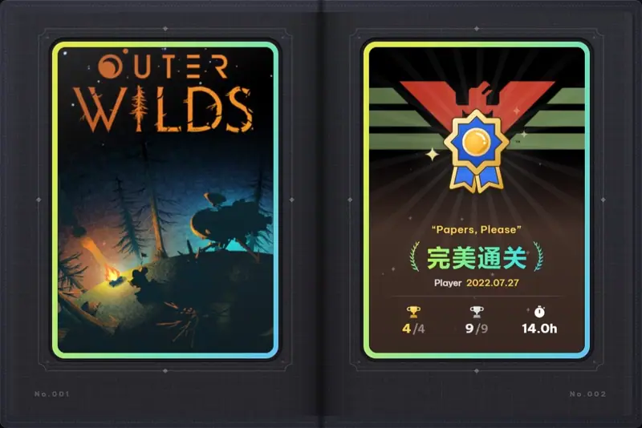</td>
  </tr>
  <tr>
    <td align="center"><b>Lightning</b> Under 15 hours; a current runs along the card's frame</td>
    <td align="center"><b>Fire</b> Under 15 hours; a trail of fire burns into place, then the card slots in</td>
  </tr>
  <tr>
    <td width="50%">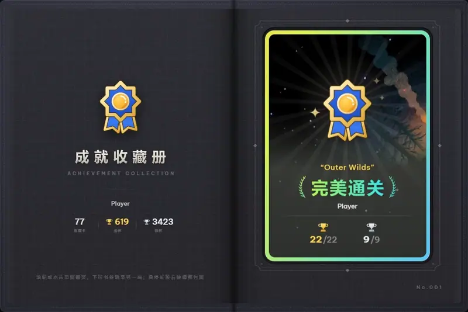</td>
    <td width="50%">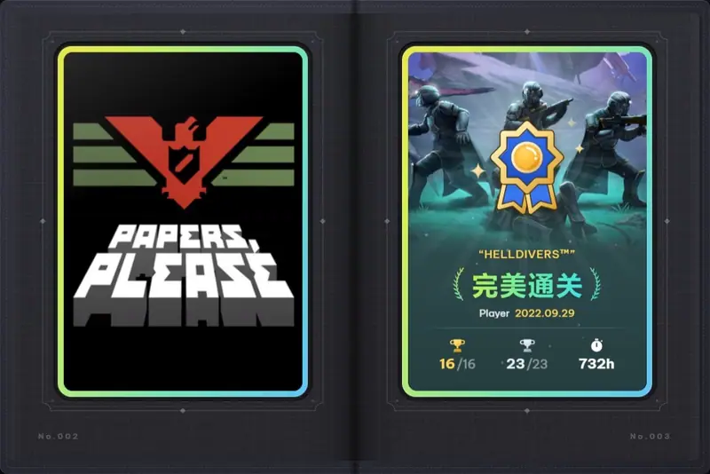</td>
  </tr>
  <tr>
    <td align="center"><b>Standard</b> 15–50 hours; rise, flip, drop into the slot</td>
    <td align="center"><b>Heavy</b> Over 50 hours; lifted, admired, then set down</td>
  </tr>
</table>

### Reading room

Lend your album to friends. When you send it out you get a 9-digit lending code. Your friend enters it in the reading room inside the client, or at <https://kevin0036.github.io/>, and can flip through a read-only copy on a computer or a phone.

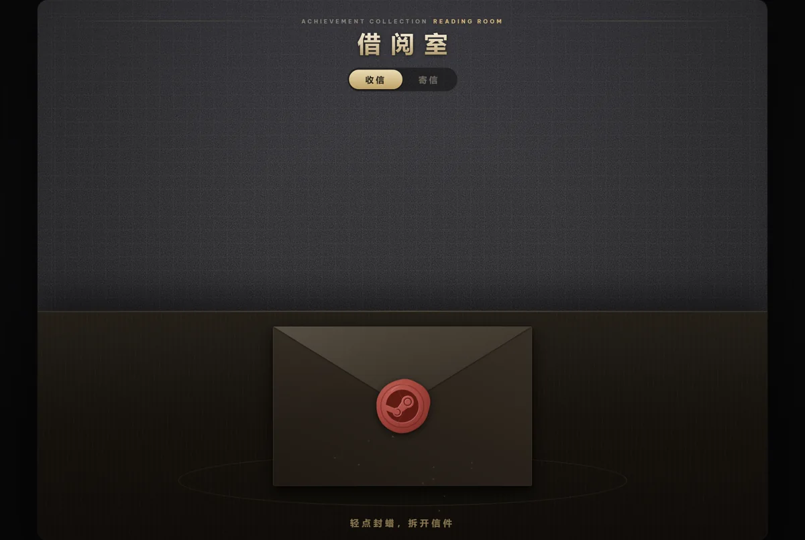

### Completionist showcase

Redesigns the completionist showcase on your Steam Community profile: covers are cropped consistently, the achievement count becomes an info bar, and each game gets a gold badge and a hover effect. Covers of region-locked or delisted games are recovered where possible.

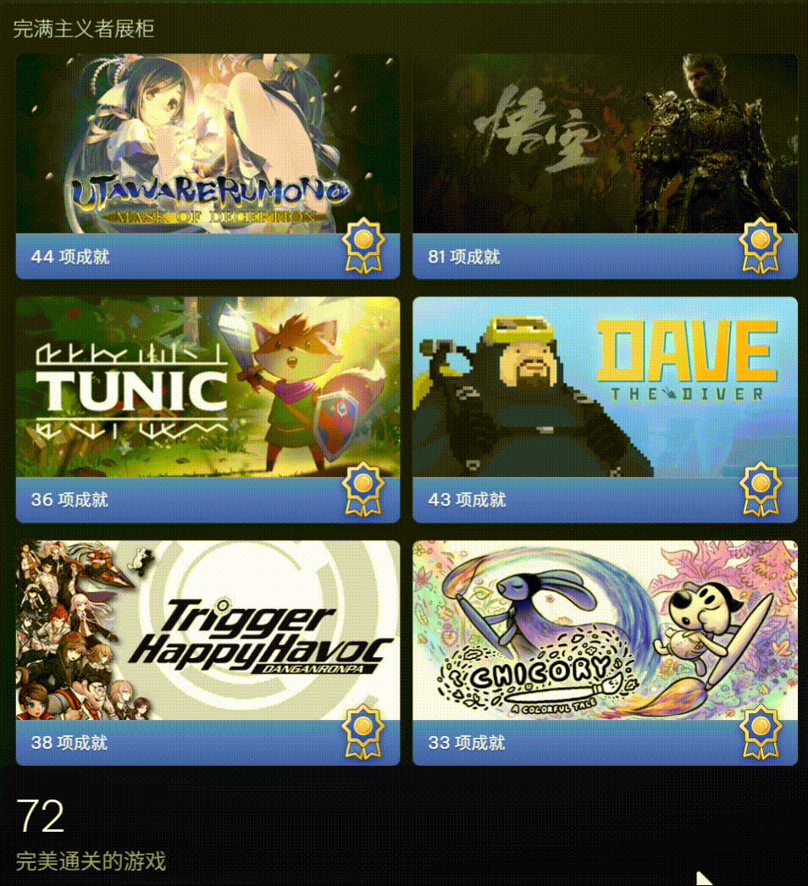

### Print-ready export

Exports achievement cards (front, back and foil layer), Favorites ticket stubs and badge stamps as 300 DPI print files with 3 mm bleed, ready to send to a printer. Find it under 「设置」 (Settings) → 「印刷素材」 (Print assets) in the top-right corner of the album.

You don't have to export every card: click 「选择」 (Select) next to 「成就卡片」 (Achievement cards) to pick cards by year or by searching for a game name. File numbers still follow the numbering in the album.

## Settings

Adjust these under 「设置」 in the top-right corner of the album, or in the 「成就收藏册」 panel of the Millennium sidebar:

| Option | Default | Description |
| --- | --- | --- |
| 单页卡片数量 (Cards per page) | 1 | One or four cards per page. |
| 装订方式 (Binding) | 顺序入册 (In order) | In order, or newest first. |
| 册子风格 (Album style) | 方格黑卡 (Black grid card) | Black grid card, dotted journal, lunar star chart or green felt table. |
| 扉页统计 (Title page stats) | On | Totals of cards and gold and silver trophies under the avatar on the title page. |
| 年份特殊页 (Year pages) | On | Group cards by completion year and add four pages at the start of each year. |
| 书口年份索引 (Year tabs) | On | Year tabs on the fore-edge; click one to jump to that year. Requires year pages. |
| 入册音效 (Card sound) | On | A soft sound when a new card drops into its slot. |
| 读取完成日期 (Read completion dates) | On | When off, completion dates are not filled in for each card, and the card pack opens faster. |
| 手动填写 (Manual entry) | — | Fill in dates and playtime by hand in the card pack, and clear them with one click. |

## Notes

- Requires the Steam client and Millennium. The plugin does not change Steam's own interface and contains no theme; fonts and colors follow whatever theme you use.
- The card pack reads achievement and library data the Steam client already has. On first use, the games you have already completed become the baseline, and no new-card animation plays for them.
- If a fresh Steam install has no achievement progress cache yet, the card pack asks Steam to build one, which can take a few seconds.
- If a game adds new achievements and you complete it again, it goes into the album as a new card. For games that use achievement sets, a new DLC set does not affect the base-game card.
- Showcase covers and badges depend on resources available on Steam; when they cannot be loaded, a placeholder or a "no badge" mark is shown.
- **Network access**: update checks go to GitHub, covers and badges come from Steam's official CDN, fonts come from Google Fonts, and the reading room connects to the share server.
- **Privacy**: a snapshot is uploaded only when you choose to send out your album. It contains your nickname, avatar, friend code (so friends can add you) and the album contents, but no login information. You can take it back at any time, and the lending code stops working immediately.

## Support

Making this takes a lot of work. If you'd like to buy me a coffee, I'd really appreciate it~

[Afdian · a membership platform connecting creators and fans](https://afdian.com/a/Kevin0036)

## Acknowledgements

The theme version of Achievement Collection was built on [SpaceTheme](https://github.com/SpaceTheme/Steam) (MIT), and the album's look and interactions carry on its style. Thanks to the SpaceTheme authors and all contributors.

The reading room's background music is *Rain with Cappuccino (Lofi Remix)* by Venvn and HANA, used with the creators' permission. The music is not included in this repository and is not covered by this project's MIT license.

If you'd like to contribute, see [dev/README.md](dev/README.md) (in Chinese) for how to build and preview.

MIT License · Copyright (c) 2023-2026 SpaceTheme
