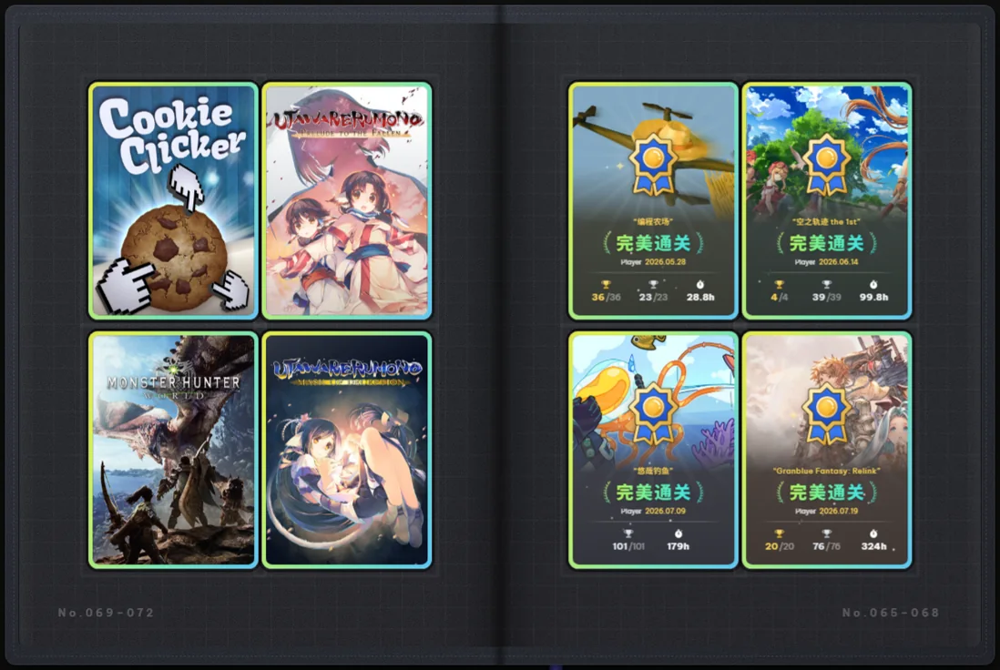
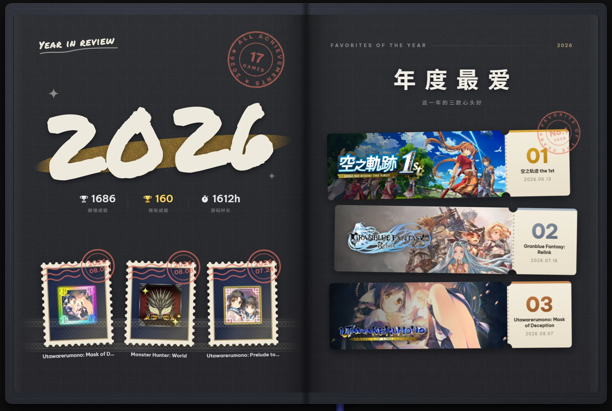
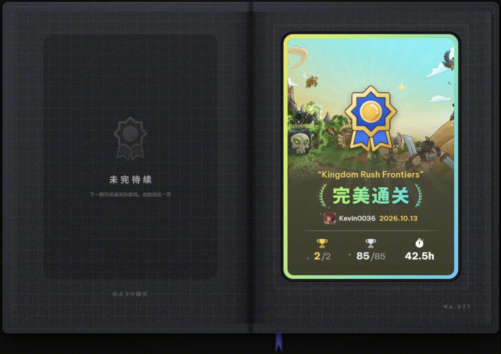
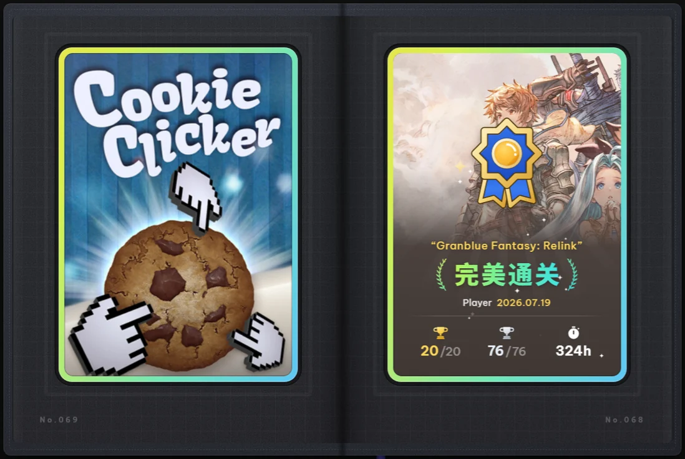

<div align="center">

<h1>成就收藏册</h1>

<p><strong>把每一款完美通关的游戏，收进一本可以翻阅的收藏册。</strong></p>

<p>Steam Millennium 插件 · <a href="https://github.com/SteamClientHomebrew/Millennium">获取 Millennium</a></p>

</div>



## 功能

### 年份特殊页

「年份特殊页」默认开启，收藏册会按完成年份分组，并在每一年的开头插入一张手账。年份手账与「年度最爱」是同一叶的正反两面，翻过去才看得到，不会同时摊开。



- **年份页**：手写年份垫一笔金色干刷笔触，右上角盖一枚红色橡皮章，写着这一年打满的款数；年份下方一行小账，记录这一年的成就数、稀有成就数与游玩小时。
- **徽章邮票**：三枚徽章做成邮票，插在集邮册的透明插袋里，膜的上下两端渐隐。票面印着等级，邮戳是这款游戏的完成日期；鼠标悬停时邮票会从插袋里往外抽一点。
- **年度最爱**：三张电影票，存根上印着名次、游戏名和日期。第 1 名的右上方会盖一枚「FAVORITE OF THE YEAR · No.1」红章，只有第 1 名选了游戏才会出现。
- **盖章动画**：翻到年份页时红章盖下，三个邮戳随后一枚接一枚补上；翻到年度最爱时，第 1 名的红章也会盖一次。换完徽章不会重盖大红章，新贴的邮票会补盖邮戳。系统开启「减少动态效果」时直接显示，不播动画。
- **选择器**：优先列出带徽章的游戏，没有徽章图案的游戏会在右上角标注。每款游戏可选普通 1–5 级或闪亮徽章，也可以直接用封面代替；选择保存在本地。
- 没有完成日期的游戏会归入最前面的「更早」一组，不生成年份页。

### 成就卡包

在 Steam 库中新增一页「成就卡包」，把所有全成就游戏装订成一本可以左右翻阅的收藏册。

卡片记录游戏封面、完成日期、成就数、稀有成就与游玩时长。第一次打开会停在最新收录的一页；右页永远是完整卡面，翻到左页则露出卡背。

点击卡片或滚动滚轮可以翻页，页码、书脊与书签会跟着移动。点击或下拉书签，会快速翻阅到离当前最远的一端（最新页或 No.001 首页）；回来时会记住上次翻到的位置。

### 新卡入册

新完成一款游戏后，第一次进入卡包会看到它从书页中央浮现、翻面，再落进预留的空卡槽。多款新游戏会按完成顺序依次入册。

只有动画完整播完，这张卡才会被记为「已入册」。如果中途离开卡包，或在入册前直接关闭 Steam，下次进入时会重新播放，不会漏掉。



### 一页一张 / 一页四张

在插件设置中切换每页卡片数量：

- **1 张**：默认，一张大卡，插画和完成信息更醒目。
- **4 张**：2×2 四张小卡，翻页次数更少，卡片等比缩放，版式不变。



### 装订方式

- **顺序入册**：默认，按入册先后排列，旧卡的位置和编号永远不动，新卡接在最后。
- **最新优先**：新卡排在前面，第一次打开停在最新收录的一页。

翻页提示会跟着装订方式换边，书签快速翻阅的落点也会对应当前装订方向。

### 扉页统计

扉页头像下方会显示收藏卡、金杯、银杯的合计。不需要的话可以在插件设置中关闭。

### 完满主义者展柜

重新设计 Steam 社区个人资料中的完满主义者展柜：封面统一裁切，成就数改为信息条，右下角加上金色徽章，悬停时卡片会轻微抬升，并高亮展现。

对于锁区、下架或客户端取不到封面的游戏，会根据 appid 重新拼接封面地址，依次尝试 `header_schinese` → `header_tchinese` → `header_japanese` → `header`。全部失效时才显示占位封面。


### 印刷素材导出

打开成就卡包后，在右上角「设置」→「印刷素材」中点击「导出印刷素材」，可以把收藏册里的收藏品按印刷规格导出：成就卡片（正面、背面，另附一张烫金层）、年度最爱票根和年份页徽章邮票。

导出为 300 DPI，四周留 3 mm 出血，送印后沿裁切线裁下即可。三类素材可以按需勾选，批量导出。

## 下载

本插件需要先安装 [Millennium](https://github.com/SteamClientHomebrew/Millennium)。到 [Releases](https://github.com/Kevin0036/steam_achievement_improve/releases/latest) 下载最新的插件包：

```text
AchievementCollection-Plugin-v1.1.4-Windows.zip
```

每个 Release 都附带各文件的 SHA256 摘要，下载后可以核对。

> 从 v1.1.1 起只发布插件版。v1.1.0 是最后一个主题版 / 懒人包版本，仍可在 Releases 中找到，但不再更新。

### 安装

1. 安装并启用 Millennium（之后可以在插件面板里检查更新，无需再手动关注版本）。
2. 解压下载的压缩包，把里面的 `AchievementCollection` 整个文件夹放进 `<Steam 安装目录>/millennium/plugins/`。
3. 重启 Steam，在 Millennium 的插件列表里启用「成就收藏册」。
4. 再重启一次 Steam 界面（或重启 Steam），库顶部菜单里会出现「★ 成就卡包」。

插件自带成就卡包、年份特殊页与展柜美化，不包含任何主题外观；字体、配色、侧栏等跟随你当前使用的主题，原版 Steam 下也能用。

### 更新

进入成就卡包时会自动检查 GitHub 上的新版本。发现更新后可以直接点「自动更新」下载并替换插件文件，重启 Steam 后生效；也可以前往发布页手动下载覆盖。

更新只替换插件文件，设置与卡册缓存都会保留。前端脚本更新后重启 Steam 界面即可生效；后端或展柜相关文件有更新时需要完整重启 Steam。

## 设置

卡册页右上角的「设置」按钮，或 Millennium 侧栏里的「成就收藏册」面板：

| 选项 | 默认 | 说明 |
| --- | --- | --- |
| 单页卡片数量 | 1 | 可选 1 或 4。修改后重新进入卡包生效。 |
| 装订方式 | 顺序入册 | 可选顺序入册或最新优先。修改后重新进入卡包生效。 |
| 扉页统计 | 开启 | 扉页头像下方的收藏卡 / 金杯 / 银杯合计。 |
| 年份特殊页 | 开启 | 按完成年份分组，每年插入一张正反手账：正面年份徽章邮票，背面年度最爱。修改后重新进入卡包生效。 |
| 年份页左右展开 | 关闭 | 年份页在左、年度最爱在右同时摊开；空出的页面保留为空白页。需先开启年份特殊页。 |
| 读取完成日期 | 开启 | 用最后一个成就的解锁时间作为完成日期。按需读取、按 appid 去重，结果缓存 30 天。 |
| 手动完成日期 | — | 可在卡包里手动补日期；面板里可一键清除全部手动日期。 |
| 版本与发布 | — | 手动检查更新，或打开发布页。 |

## 说明

- 需要 Steam 客户端与 Millennium；插件兼容其它主题与原版 Steam，不修改 Steam 自带界面以外的内容。
- 成就卡包读取 Steam 客户端已有的成就与库数据；首次使用会把当前的全成就游戏作为基准，不会播放旧卡的入册动画。
- 新装的 Steam 还没有成就进度缓存时，卡包会请 Steam 建立一次缓存，可能需要等待几秒。
- 游戏新增成就、从「全成就」变回「未完成」后再次打满，会重新作为新收录入册。
- 展柜封面与年份页徽章依赖对应游戏存在可用的客户端资源；取不到时会显示占位图或「无徽章」标记。
- 插件会访问 GitHub 检查与下载更新；除此之外不进行任何网络请求。

## 打赏

制作不易，如果能请我喝一杯瑞幸我会很感动~

[爱发电 · 连接创作者与粉丝的会员制平台](https://afdian.com/a/Kevin0036)

## 致谢

成就收藏册的主题版基于 [SpaceTheme](https://github.com/SpaceTheme/Steam)（MIT）开发，卡册的视觉与交互也延续了它的风格。感谢 SpaceTheme 的作者与所有贡献者。

MIT License · Copyright (c) 2023-2026 SpaceTheme
