

<h1>成就收藏册</h1>

<strong>把每一款完美通关的游戏，收进一本可以翻阅的收藏册。</strong>

Steam Millennium 插件 · 原版 Steam 和其他主题下都能用

  
  
  

  <a href="#安装"><b>安装</b></a> · <a href="#功能">功能</a> · <a href="#设置">设置</a> · <a href="#说明">说明</a> · <a href="#打赏">打赏</a>

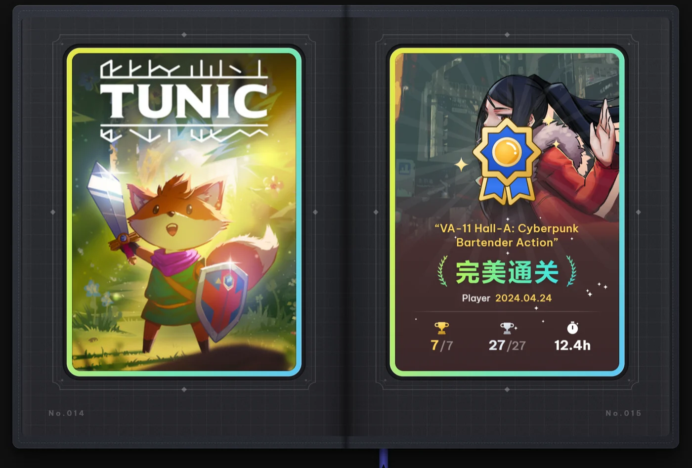

## 安装

到 [Releases](https://github.com/Kevin0036/steam_achievement_improve/releases/latest) 下载最新版本，按你的情况选一个：

| | 适合 | 下载 |
| --- | --- | --- |
| **懒人包** | 没装过 Millennium，想一步到位 | `AchievementCollection-Lazy-版本号-Windows.zip` |
| **插件版** | 已经在用 Millennium | `AchievementCollection-Plugin-版本号-Windows.zip` |

**懒人包**：解压后双击 `Install.bat`，脚本会自动找到 Steam，装好 Millennium 和插件。已经装过 Millennium 也能用它更新插件，不会动你的其他主题和插件。

**插件版**：

1. 安装并启用 [Millennium](https://github.com/SteamClientHomebrew/Millennium)。
2. 解压后，把 `AchievementCollection` 整个文件夹放进 `<Steam 安装目录>/millennium/plugins/`。
3. 重启 Steam，在 Millennium 的插件列表里启用「成就收藏册」。
4. 再重启一次 Steam，库顶部菜单里就会出现「★ 成就卡包」。

**更新**：进入卡包时会自动检查新版本，点「自动更新」后重启 Steam 即可，设置和卡册缓存都会保留。

## 功能

### 成就卡包

在 Steam 库中新增一页「成就卡包」，把所有全成就游戏装订成一本可以左右翻阅的收藏册。卡片记录游戏封面、完成日期、成就数、稀有成就和游玩时长。

- **翻页**：滚动滚轮，或者点击左右两页的任意位置。
- **快速翻阅**：点击或下拉书签，直接翻到册子另一端，回来时记得上次的位置。
- **版式**：一页一张大卡，或者一页四张小卡。
- **装订**：「顺序入册」让旧卡的位置和编号永远不变，「最新优先」把新卡排在前面。

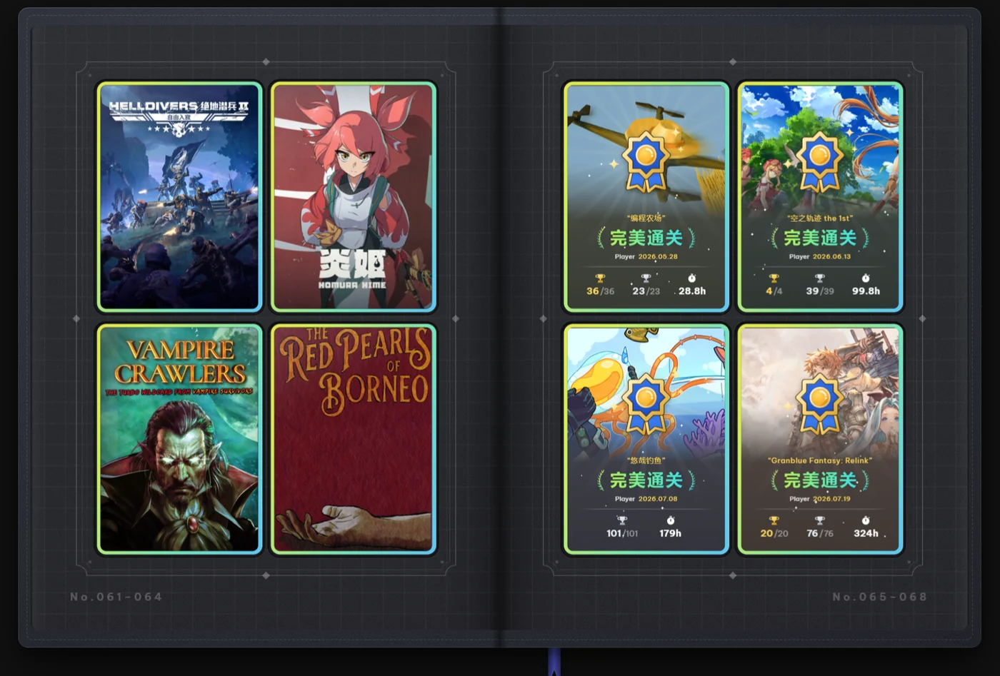

### 册子风格

四本册子，纸张、书皮、书签和卡位各不相同。在设置里切换，立即生效。

<table>
  <tr>
    <td width="50%">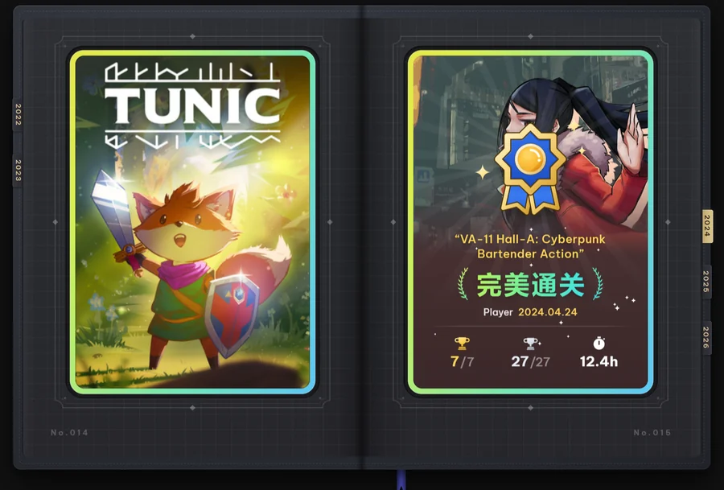</td>
    <td width="50%">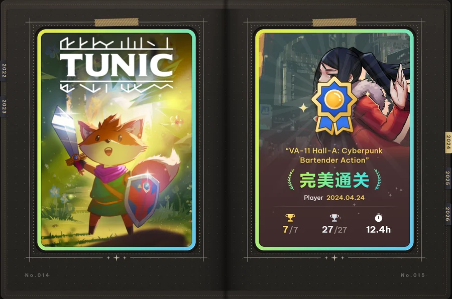</td>
  </tr>
  <tr>
    <td align="center"><b>方格黑卡</b> 黑卡纸上印着极淡的方格</td>
    <td align="center"><b>墨点手账</b> 暖黑纸配点阵，卡位只留四角裁切线</td>
  </tr>
  <tr>
    <td width="50%">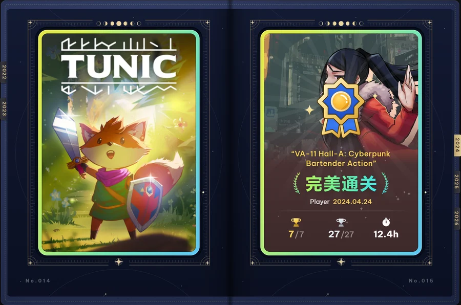</td>
    <td width="50%">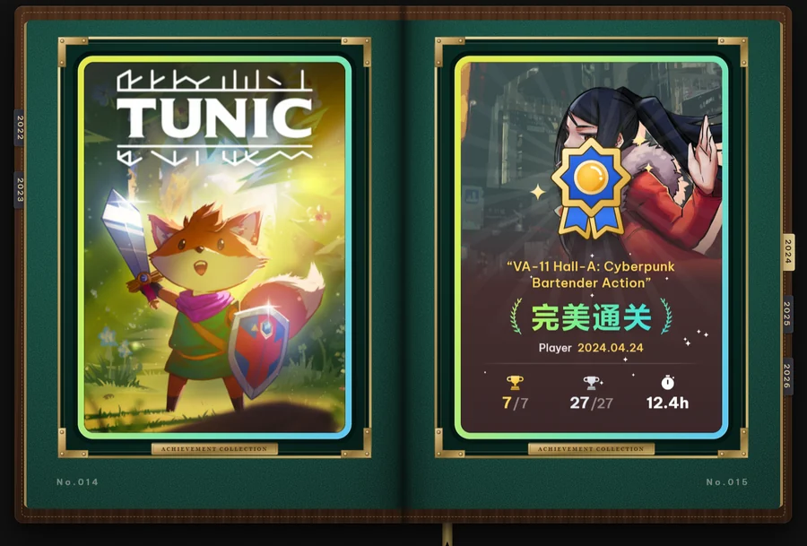</td>
  </tr>
  <tr>
    <td align="center"><b>星图</b> 深蓝底上印一张淡金星图</td>
    <td align="center"><b>丝绒展柜</b> 祖母绿绒面、胡桃木外框、黄铜卡框</td>
  </tr>
</table>

### 年份特殊页

收藏册按完成年份分组，每一年的开头有四页。

**年份页与年度最爱**摊开在同一个跨页上：左边是这一年的数据和三枚徽章邮票，右边是你最喜欢的三款游戏。邮票和票根都可以自己挑。

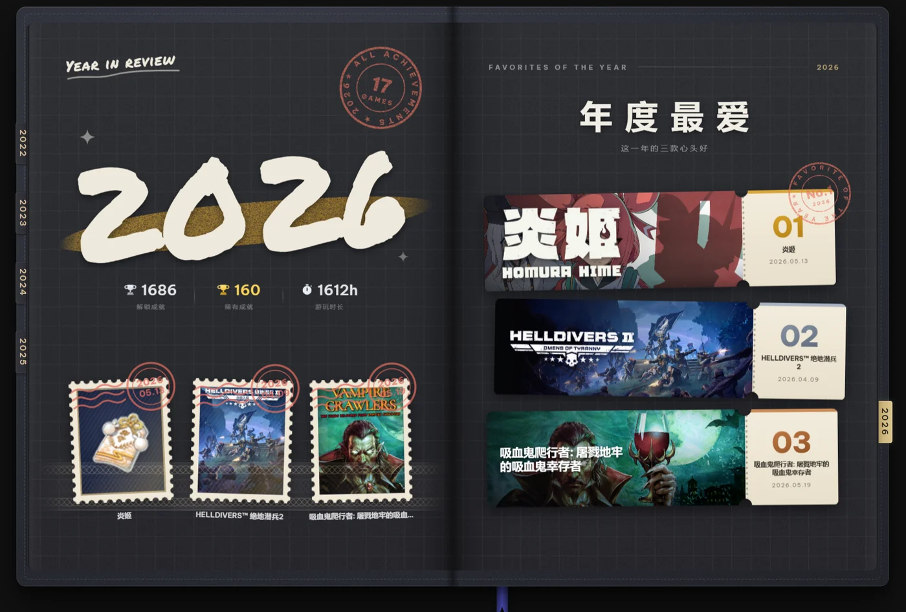

**月份足迹**和**本年目录**分别在这个跨页的前后：足迹让你看到这一年是怎么走过来的，目录点一行就能翻到那张卡。

<table>
  <tr>
    <td width="50%">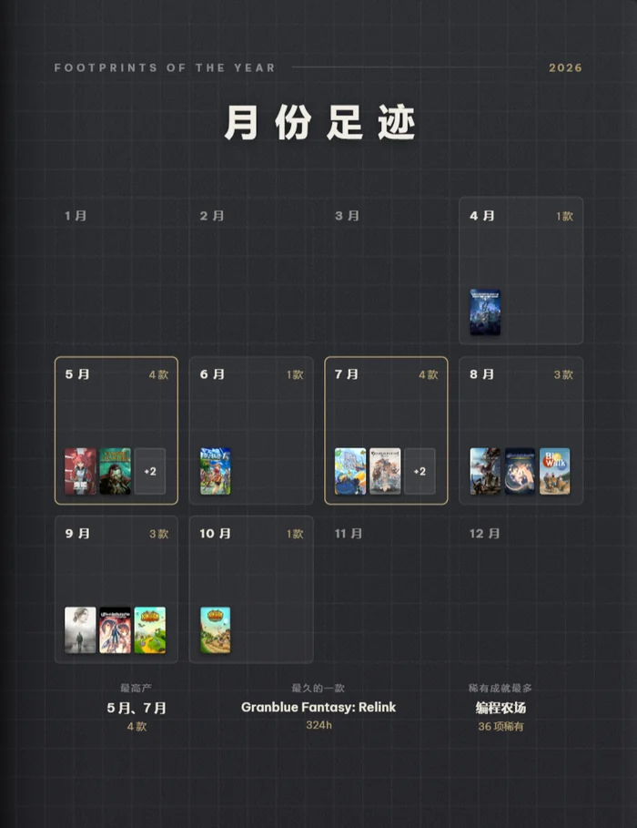</td>
    <td width="50%">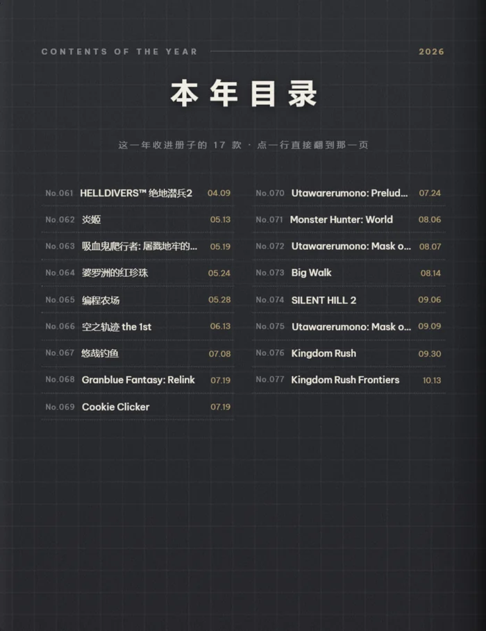</td>
  </tr>
  <tr>
    <td align="center"><b>月份足迹</b> 每个月打满了哪些游戏，以及最高产的月份、最久和稀有成就最多的一款</td>
    <td align="center"><b>本年目录</b> 这一年的全部游戏，点一行直接翻到那一页</td>
  </tr>
</table>

书口还有一列年份标签，点一下直接跳到那一年。

更多细节

- 翻到年份页时红章盖下，三个邮戳随后一枚接一枚补上；系统开启「减少动态效果」时直接显示，不播动画。
- 每款游戏可选普通 1–5 级或闪亮徽章，也可以直接用封面代替，没有徽章图案的游戏会标注出来。
- 第 1 名的票根上会盖一枚「FAVORITE OF THE YEAR · No.1」红章。
- 没有完成日期的游戏归入最前面的「更早」一组，不生成年份页。

### 新卡入册

新完成一款游戏后，第一次进入卡包会看到它从书页中央浮现、翻面，再落进预留的卡槽。中途离开或关闭 Steam 也不会漏掉，下次进入时会重新播放。

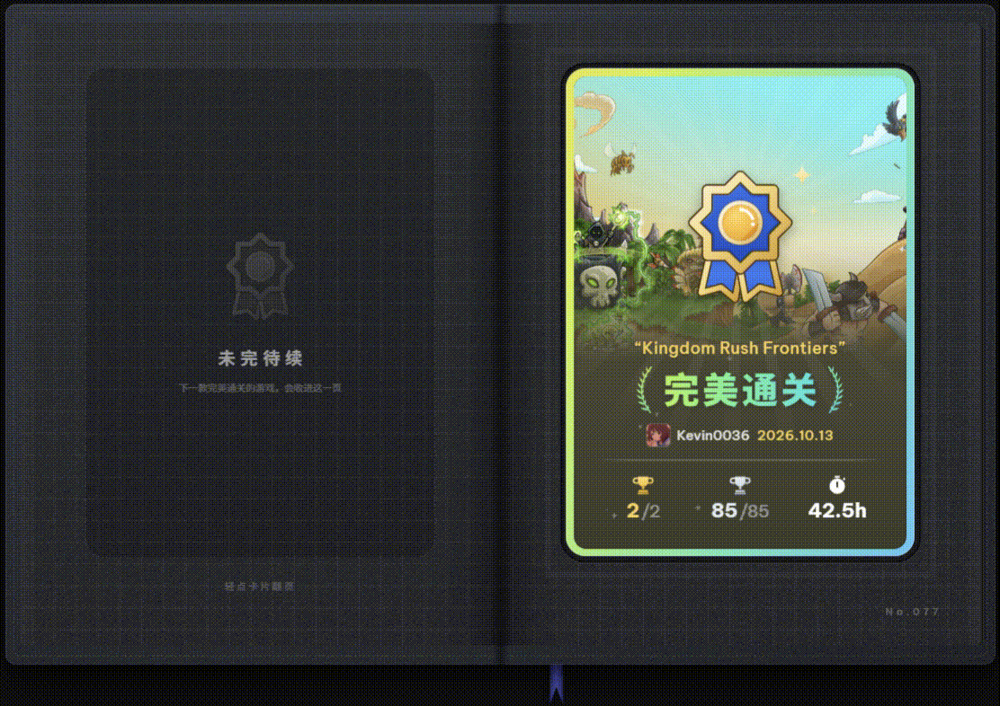

### 借阅室

把你的册子寄给朋友看。寄出后会得到一个 9 位借阅码，朋友在客户端的借阅室，或者打开 <https://kevin0036.github.io/> 输入借阅码，就能翻阅一份只读副本，电脑和手机都可以。

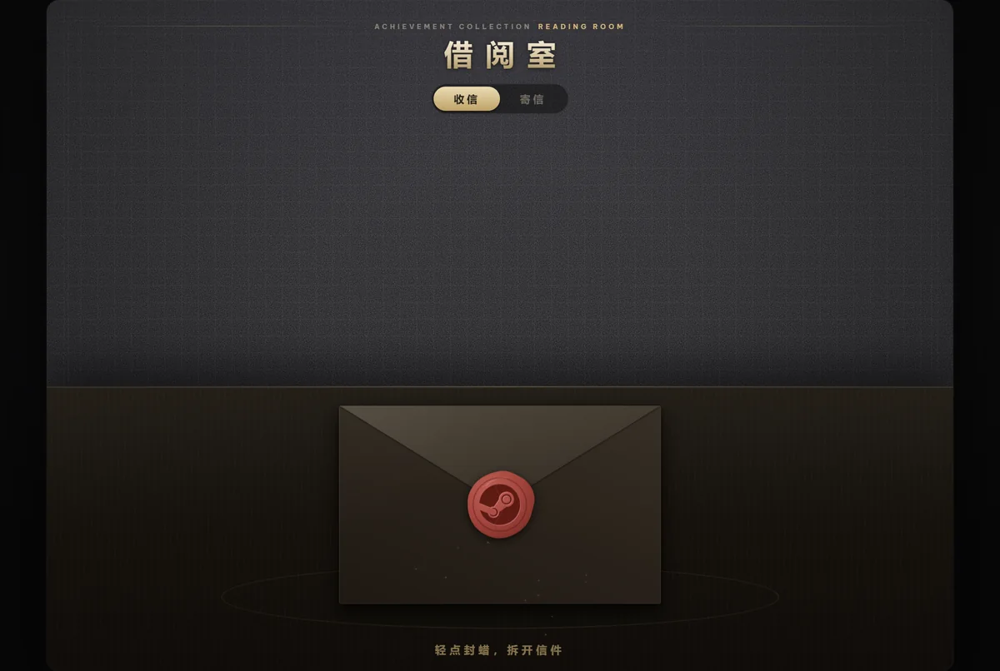

### 完满主义者展柜

重新设计 Steam 社区个人资料里的完满主义者展柜：封面统一裁切，成就数改成信息条，加上金色徽章和悬停效果。锁区或下架的游戏也会尽量找回封面。

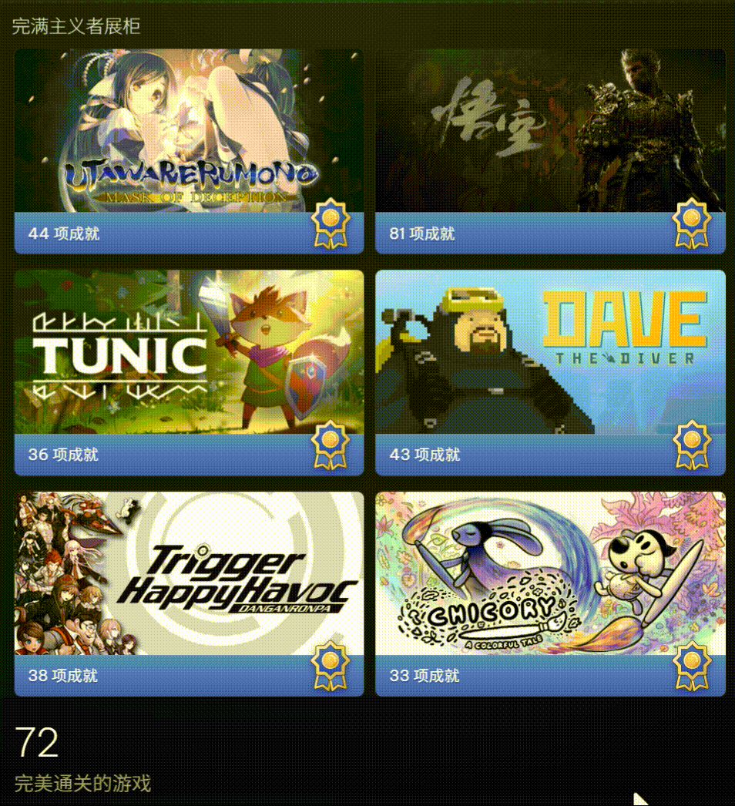

### 印刷素材导出

把成就卡片（正面、背面和烫金层）、年度最爱票根和徽章邮票导出成 300 DPI、带 3 mm 出血的印刷文件，可以直接送印。在卡册右上角「设置」→「印刷素材」里使用。

## 设置

在卡册页右上角的「设置」，或 Millennium 侧栏的「成就收藏册」面板里调整：

| 选项 | 默认 | 说明 |
| --- | --- | --- |
| 单页卡片数量 | 1 | 一页一张或一页四张。 |
| 装订方式 | 顺序入册 | 顺序入册或最新优先。 |
| 册子风格 | 方格黑卡 | 方格黑卡、墨点手账、星图、丝绒展柜。 |
| 扉页统计 | 开启 | 扉页头像下方的收藏卡、金杯、银杯合计。 |
| 年份特殊页 | 开启 | 按完成年份分组，每年开头插入四页。 |
| 书口年份索引 | 开启 | 书口露出年份标签，点一下跳到那一年。需要开启年份特殊页。 |
| 读取完成日期 | 开启 | 关闭后不补全每张卡的完成日期，打开卡包更快。 |
| 手动填写 | — | 可以在卡包里手动补日期和时长，也能一键清除。 |

## 说明

- 需要 Steam 客户端和 Millennium。插件不修改 Steam 自带的界面，也不包含主题外观，字体和配色跟随你当前使用的主题。
- 卡包读取 Steam 客户端已有的成就和库数据。第一次使用时，会把当前的全成就游戏作为基准，不播放旧卡的入册动画。
- 新装的 Steam 还没有成就进度缓存时，卡包会请 Steam 建立一次，可能要等几秒。
- 游戏新增成就后再次打满，会重新作为新收录入册。
- 展柜封面和徽章依赖 Steam 上可用的资源，取不到时显示占位图或「无徽章」标记。
- **网络访问**：检查更新访问 GitHub，封面和徽章来自 Steam 官方 CDN，字体来自 Google Fonts，借阅室连接分享服务器。
- **隐私**：只有你主动寄出册子时才会上传快照。快照包含昵称、头像、好友代码（朋友可以用它加你）和册子内容，不包含登录信息。你可以随时收回，收回后借阅码立即失效。

## 打赏

制作不易，如果能请我喝一杯瑞幸我会很感动~

[爱发电 · 连接创作者与粉丝的会员制平台](https://afdian.com/a/Kevin0036)

## 致谢

成就收藏册的主题版基于 [SpaceTheme](https://github.com/SpaceTheme/Steam)（MIT）开发，卡册的视觉与交互也延续了它的风格。感谢 SpaceTheme 的作者与所有贡献者。

借阅室的背景音乐是 Venvn、HANA 的 *Rain with Cappuccino (Lofi Remix)*，经作者同意使用。音乐不包含在这个仓库里，也不在本项目的 MIT 许可范围内。

想参与开发的话，构建和预览方法见 [dev/README.md](dev/README.md)。

MIT License · Copyright (c) 2023-2026 SpaceTheme
