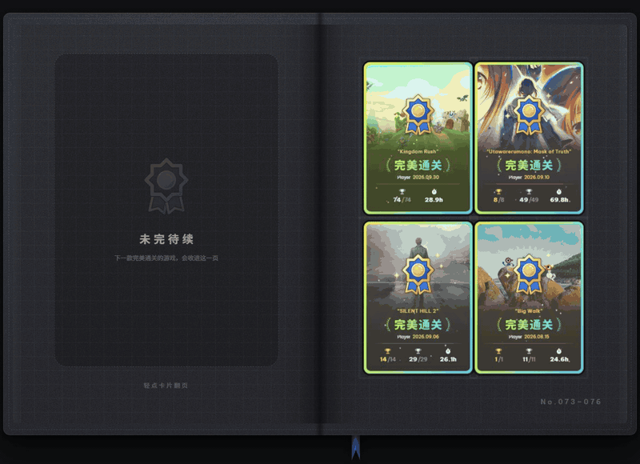

<h1>成就收藏册</h1>

<strong>把每一款完美通关的游戏，收进一本可以翻阅的收藏册。</strong>

Steam Millennium 主题 · 基于 <a href="https://github.com/SpaceTheme/Steam">SpaceTheme</a>

## 功能

### 成就卡包

在 Steam 库中新增一页「成就卡包」，把所有全成就游戏装订成一本可以左右翻阅的收藏册。

卡片记录游戏封面、完成日期、成就数、稀有成就与游玩时长；点击卡片翻页，页码、书脊与书签会跟着移动。收藏再多，也能一页页翻过去。

### 新卡入册

新完成一款游戏后，第一次进入卡包会看到它从书页中央浮现、翻面，再落进预留的空卡槽。多款新游戏会按完成顺序依次入册。

只有动画完整播完，这张卡才会被记为「已入册」。如果中途离开卡包，或在入册前直接关闭 Steam，下次进入时会重新播放，不会漏掉。

### 一页一张 / 一页四张

在主题设置中切换每页卡片数量：

- **1 张**：默认，一张大卡，插画和完成信息更醒目。
- **4 张**：2×2 四张小卡，翻页次数更少，卡片等比缩放，版式不变。

### 完满主义者展柜

重新设计 Steam 社区个人资料中的完满主义者展柜：封面统一裁切，成就数改为信息条，右下角加上金色徽章，悬停时卡片会轻微抬升，并高亮展现。

对于锁区、下架或客户端取不到封面的游戏，会根据 appid 重新拼接封面地址，依次尝试 `header_schinese` → `header_tchinese` → `header_japanese` → `header`。全部失效时才显示占位封面。

## 下载

提供两个版本，按自己的情况选一个：

| 版本 | 适合谁 | 文件 |
| --- | --- | --- |
| **主题版** | 已经装好 Millennium，或以后只想更新主题 | `AchievementCollection-v1.0.1.zip` |
| **Windows 懒人包** | 原生 Steam，第一次安装 | `AchievementCollection-Lazy-v1.0.1-Windows.zip` |

到 [Releases](https://github.com/Kevin0036/steam_achievement_improve/releases/latest) 下载，每个 Release 都附带 `SHA256SUMS.txt`。

> 懒人包内置官方原版 Millennium v3.6.2，不需要再去官方渠道慢速下载。仅支持 64 位 Windows 版 Steam。

### 主题版安装

1. 下载并解压，得到含 `skin.json` 的 `AchievementCollection` 文件夹。
2. 把它放进 `<Steam 安装目录>/millennium/themes/`。放好后，`themes/AchievementCollection/skin.json` 应直接存在。
3. 重启 Steam，在 Millennium 设置 → Themes 中选择「成就收藏册」。
4. 打开 Steam 库，在顶部导航菜单中点击「★ 成就卡包」。

### 懒人包安装

1. 完全退出 Steam。
2. 解压整个压缩包（不要只拖出 `Install.bat`），双击 `Install.bat`。
3. 脚本会自动查找 Steam 目录，必要时请求管理员权限；安装前会校验内置 Millennium 压缩包的 SHA256。
4. 完成后启动 Steam，在 Millennium 设置 → Themes 中选择「成就收藏册」。

安装器不会覆盖已有的 Millennium；检测到已安装时，只会安装或更新主题。卸载时双击 `Uninstall.bat`：默认只删除主题，只有确认 Millennium 是由懒人包装入的，才提供连同核心一起卸载的选项。内置的 Millennium 为官方原版，不会自动更新。

如果杀毒软件或 SmartScreen 拦截安装脚本，请先确认文件来自本仓库的 Release 并核对 SHA256；来源不明时不要绕过拦截。

如果卡包入口没有出现，可在主题设置中打开「成就卡包：允许全屏式入口」，再重启 Steam。

## 设置

主题设置中的 **Library → 成就卡包**：

| 选项 | 默认 | 说明 |
| --- | --- | --- |
| 单页卡片数量 | 1 | 可选 1 或 4。修改后重新进入卡包生效。 |
| 成就卡包：读取完成日期 | 开启 | 用最后一个成就的解锁时间作为完成日期。按需读取、按 appid 去重，结果缓存 30 天。 |
| 成就卡包：允许全屏式入口 | 关闭 | 主入口失效时，用整页替换库外壳的方式打开卡包。 |

## 说明

- 主题版需要 Steam 客户端与 Millennium；懒人包已内置 Millennium。主题本身基于 SpaceTheme，库、商店、社区等页面的整体外观也会随之变化。
- 成就卡包读取 Steam 客户端已有的成就与库数据；首次使用会把当前的全成就游戏作为基准，不会播放旧卡的入册动画。
- 新装的 Steam 还没有成就进度缓存时，卡包会请 Steam 建立一次缓存，可能需要等待几秒。
- 游戏新增成就、从「全成就」变回「未完成」后再次打满，会重新作为新收录入册。
- 展柜封面依赖对应游戏存在可用的 header 资源；全部语言版本都缺失时，只能显示占位图。

## 打赏

制作不易，如果能请我喝一杯瑞幸我会很感动~

[爱发电 · 连接创作者与粉丝的会员制平台](https://afdian.com/a/Kevin0036)

## 致谢

本主题是 [SpaceTheme](https://github.com/SpaceTheme/Steam)（MIT）的个人化分支，保留了其整体视觉与主题框架，并新增成就卡包与完满主义者展柜美化。

MIT License · Copyright (c) 2023-2026 SpaceTheme
